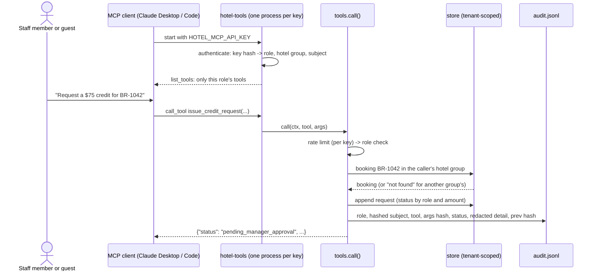

# Architecture

## One call, start to finish

## Components

| Module | Job |
|---|---|
| `server.py` | Authenticates the key at start, registers only the role's tools on an `MCPServer`, runs stdio |
| `tools.py` | The seven tools as plain functions; `call()` = rate limit → role check → tool → audit |
| `rbac.py` | Role → tools table and role → booking fields |
| `auth.py` | Key hashing, keys file, `Principal(role, hotel_group_id, subject)` |
| `store.py` | Synthetic bookings / activities (read-only), requests (append-only JSONL); every read takes the tenant |
| `guard.py` | Removes instruction-like sentences from tool results |
| `audit.py` | Append-only, hash-chained audit log with redacted details |
| `ratelimit.py` | Per-key sliding window by role |
| `policy/` | Stage 1's BM25 search and PII redaction, copied at v1.6.0 by `scripts/sync_policy.py` (checked in CI) |

## Data

| File | Contents |
|---|---|
| `data/tenants.json` | Two synthetic hotel groups: `hg-demo` (Beach Resort, Mountain Lodge) and `hg-other` (only for isolation tests) |
| `data/bookings.json` | 10 synthetic bookings; one guest email appears in both groups on purpose |
| `data/activities.json` | 7 activities; one description contains a planted instruction on purpose |
| `data/policy/raw/` | Stage 1's synthetic documents (one staff note contains a planted instruction) |

## Scaling path

See the README's "Design at scale": Postgres with row-level security, streamable HTTP with OAuth, rate limits in a
shared store, the index built in CI.
